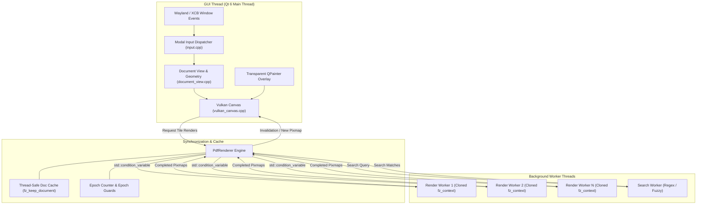
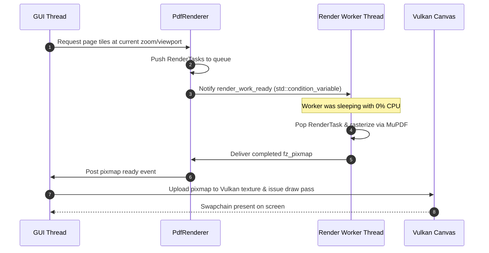
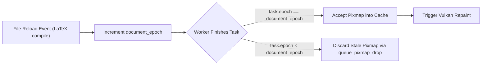
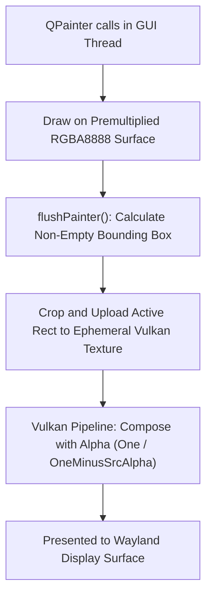

# 🏗️ Sioyek 3.0 Architecture & Internals

This document provides an in-depth technical overview of Sioyek's modernized, Linux-focused architecture (v3.0.0-dev), highlighting the **Vulkan hardware renderer**, **multi-threaded MuPDF rasterization**, **condition-variable concurrency**, and **native Wayland presentation**.

---

## 📑 Contents

1. [High-Level Architecture](#sec-architecture)
2. [Vulkan Hardware Rendering (`QRhiWidget`)](#sec-vulkan)
3. [Multi-Threaded Concurrency Engine](#sec-concurrency)
4. [Epoch-Based Cache Invalidation](#sec-epoch)
5. [Transparent Vector Overlay Blending](#sec-overlay)
6. [Input Modal Tree & Command Dispatch](#sec-input)
7. [Hardened Security & Toolchain](#sec-security)

---

## 1. High-Level Architecture {#sec-architecture}

Sioyek enforces a strict separation of concerns across multiple threads:
- **GUI & Composition Thread**: Manages Wayland/X11 surface events, handles user input, dispatches commands, and executes Vulkan render passes.
- **Render Worker Pool (N Threads)**: Concurrently rasterizes PDF slices and tiles into memory using isolated, cloned MuPDF contexts.
- **Search Worker Thread**: Executes non-blocking regex and fuzzy text searches with cooperative interruption.

---

## 2. Vulkan Hardware Rendering (`QRhiWidget`) {#sec-vulkan}

### 2.1 The Qt Rendering Hardware Interface (QRhi)
Earlier versions of Sioyek relied on legacy OpenGL immediate-mode or early programmable pipelines. In v3.0, the graphics subsystem has transitioned entirely to **Qt 6's QRhi (Vulkan Backend)**:

* **Pre-compiled SPIR-V Shaders**: Shaders (`canvas.vert` and `canvas.frag`) are pre-compiled into SPIR-V bytecodes ahead-of-time during build using `qsb` and embedded as Qt binary resources (`:/shaders/vulkan/*.qsb`). No runtime compiler or GLSL driver overhead exists in the shipping executable.
* **Direct Wayland Subsurface Binding**: `QRhiWidget` creates Vulkan swapchains directly connected to Wayland subsurfaces, bypassing XWayland latency and fractional scaling distortion.
* **Pipeline State Caching**: Samplers, blend states, and dynamic uniform buffers are cached via lightweight `PipelineKey` descriptors.

### 2.2 QRhi ABI Compatibility Contract
Because `QRhiWidget` resides in Qt's private GUI layer (`Qt6::GuiPrivate`), its binary interface depends on Qt's exact internal struct layout.
* Sioyek's Arch Linux packaging enforces strict dependency pinning (`qt6-base=X.Y.Z`).
* When Arch updates Qt across minor versions, Sioyek must be recompiled to guarantee ABI stability.

---

## 3. Multi-Threaded Concurrency Engine {#sec-concurrency}

### 3.1 Eliminating Busy Polling
Legacy rendering engines often use sleep-and-poll loops to check for incoming render requests. Sioyek 3.0 uses true OS synchronization primitives:
* `std::condition_variable render_work_ready` wakes idle workers immediately when tile render jobs are queued, sleeping with zero CPU utilization when idle.
* `std::condition_variable search_work_ready` coordinates background text searching with cooperative, instantaneous cancellation when the user types a new character.

### 3.2 MuPDF Context Isolation & Native Pointer Alignment
MuPDF's concurrency model requires strict isolation:
* **Context Cloning**: Each render worker thread operates on its own cloned `fz_context`. Cloned contexts share underlying font caches and memory allocators safely via MuPDF's internal mutexes.
* **Reference Counting**: Document handles are retained across threads using `fz_keep_document` and safely released with `fz_drop_document`.
* **8-Byte Memory Alignment**: The MuPDF build config enforces `FZ_POINTER_ALIGN_MOD=FZ_MEMORY_BLOCK_ALIGN_MOD`, guaranteeing 8-byte pointer alignment for complex glyph paths and eliminating UBSan memory alignment traps.

---

## 4. Epoch-Based Cache Invalidation {#sec-epoch}

When a document is reloaded (e.g. from an external LaTeX compilation) or resized:
1. An atomic `document_epoch` counter is incremented.
2. In-flight background workers compare their task's stamp against the current epoch.
3. If the epoch has changed, stale pixmaps are discarded immediately instead of contaminating the cache.
4. Deferred pixmap disposal (`queue_pixmap_drop`) releases memory safely on the worker's own context without blocking the main GUI thread.

---

## 5. Transparent Vector Overlay Blending {#sec-overlay}

To render high-contrast vector elements (status bar, document search highlights, portal borders, and command hints) smoothly over Vulkan-rendered PDF pages:

* Unused transparent regions are never uploaded to GPU memory, preserving PCIe bandwidth and minimizing VRAM pressure.

---

## 6. Input Modal Tree & Command Dispatch {#sec-input}

Sioyek handles keyboard input using a prefix tree (trie) data structure:
* **Modal Contexts**: Modes such as `ruler`, `overview`, `visual_scroll`, and `portal` swap the active root of the input trie.
* **Prefix Disambiguation**: Sequences like `gg`, `gc`, `gnh`, `gB` are resolved without key collision or lag.
* **Safe Resets**: Unbound keys reset the parser cleanly to the root state without corrupting or dropping subsequent key events.

---

## 7. Hardened Security & Toolchain {#sec-security}

All binaries are compiled under C++20 with enterprise-grade compiler hardening:
* `-fstack-protector-strong` & `-fstack-clash-protection`: Detects and thwarts stack buffer exploits.
* `-fcf-protection=full`: Enables Intel Control-Flow Enforcement (CET) for branch tracking.
* `-ftrivial-auto-var-init=zero`: Initializes all automatic variables to zero, eliminating uninitialized stack vulnerabilities.
* `_FORTIFY_SOURCE=3`: Enforces runtime boundary checks on memory and string operations.
* `-Werror`: Strictly zero-warning compilation under modern GCC and Clang.
